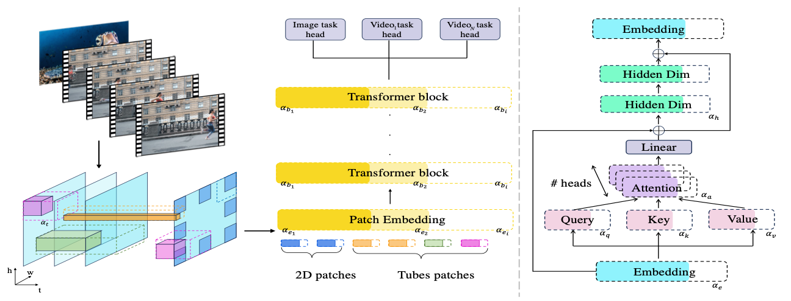
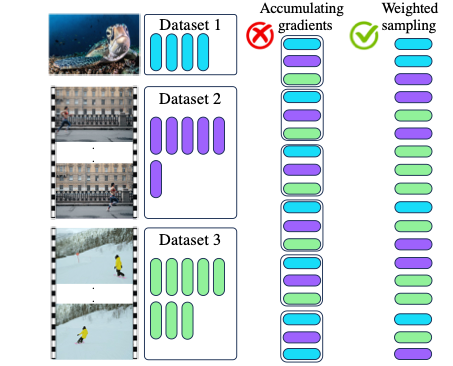
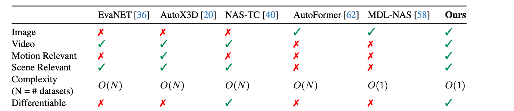
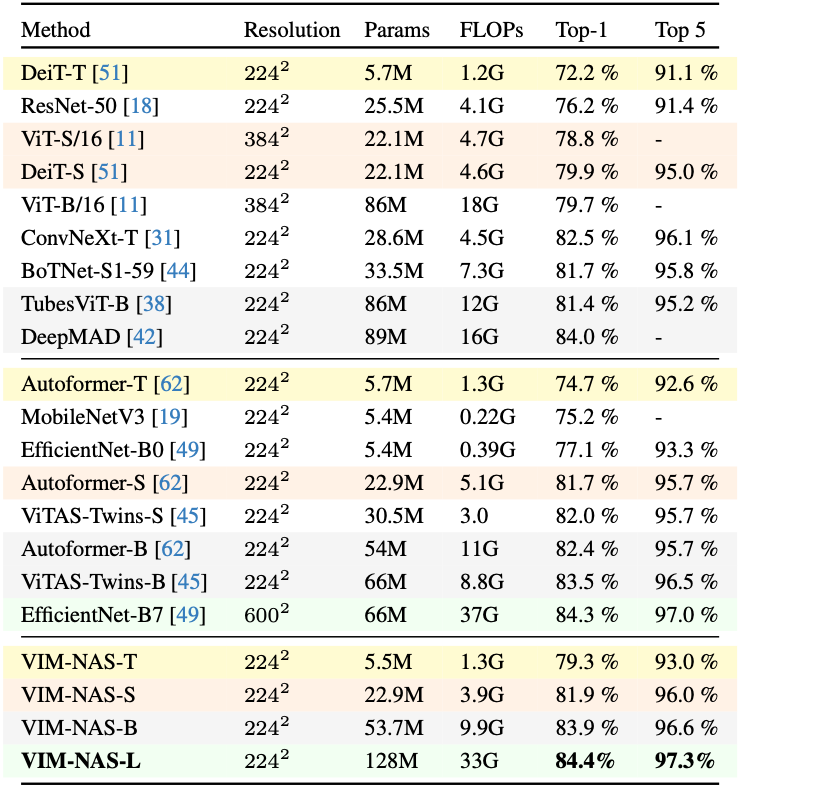

# VIM-NAS: NAS Just Once for Joint Image-Video Recognition

Official research code for **VIM-NAS** (Videos-IMages NAS): one-shot neural architecture search over vision transformers that handles images and videos with a single supernet. It extends the weight-entanglement supernet of [AutoFormer](https://github.com/microsoft/Cream/tree/main/AutoFormer) to video.

## Paper

**NAS Just Once: Neural Architecture Search for Joint Image-Video Recognition**
Sofia Casarin (Free University of Bozen-Bolzano), Sergio Escalera (Computer Vision Center / Universitat de Barcelona), Oswald Lanz (Free University of Bozen-Bolzano)
2025 IEEE/CVF International Conference on Computer Vision Workshops (ICCVW), 2025, pp. 6431-6441.

[](https://ieeexplore.ieee.org/document/11375617/)
[](https://doi.org/10.1109/ICCVW69036.2025.00667)

[DOI](https://doi.org/10.1109/ICCVW69036.2025.00667) | [IEEE Xplore](https://ieeexplore.ieee.org/document/11375617/)

**Abstract (short).** VIM-NAS is the first NAS approach that bridges NAS for videos and images: a single differentiable, weight-entangled one-shot search over a unique supernet of Vision Transformers that jointly optimizes 2D patches (images) and 3D space-time tubes (videos), embedding dim, Q-K-V dim, number of heads, MLP ratio and depth. With multi-dataset joint training, VIM-NAS reaches 84.4% top-1 on ImageNet, 90.7% on Kinetics-400, improves the state of the art on Kinetics-600 by 0.4% and the previous NAS state of the art on Something-Something V2 by 13.4%.

<p align="center"></p>

**Figure 1.** Left: overall components of the VIM-NAS supernet, which processes images and videos through dynamic 2D and 3D sparse overlapping tubes; the search space includes different tube shapes, dynamic transformer blocks in each layer, and depths, trained through weight entanglement. Right: the ViT block where embedding dimension, number of heads, MLP ratio and Q-K-V dim are optimized.

<p align="center"></p>

**Figure 2.** Dataset sampling schedule for joint training: each dataset is sampled with a probability proportional to its size, without accumulating gradients.

<p align="center"></p>

**Table 1.** Properties of VIM-NAS compared to leading NAS methods for video action recognition, image classification and Vision Transformers.

<p align="center"></p>

**Table 3.** ImageNet-1k results: hand-designed models, NAS-designed models, and the VIM-NAS models (Tiny/Small/Base/Large).

### Mapping to code

- `Tubes_AF/` holds the VIM-NAS supernet and search: the supernet with a sparse-tubes tokenizer (`model/module/embedding_super.py`, `model/supernet_transformer.py`) and 2D/3D positional encodings (`tubevit/`); joint multi-dataset training (`supernet_multi_train.py`, `lib/multi_datasets.py`), where at each step the dataset is drawn with probability proportional to its number of steps (`lib/samplers.py: get_next_train_modularity`); and evolutionary search (`evolution.py`). The supernet configs in `experiments/` search embedding dim, number of heads, MLP ratio and depth.
- `Masked_AutoFormer/` holds masked-autoencoder pre-training / fine-tuning utilities and the Kinetics video pipeline, which `Tubes_AF` reuses.

The released code is a research snapshot; some configs and defaults may not match the exact settings reported in the paper.


## Contents

- **[`Tubes_AF/`](Tubes_AF/README.md)**: AutoFormer-style supernet for video. Adds a sparse-tubes tokenizer (`SparseTubesTokenizerSuper`), 3D sin-cos positional encodings (`tubevit/`), a self-attention-pooling head, and single/multi-dataset supernet training (`supernet_train.py`, `supernet_multi_train.py`) plus evolutionary search (`evolution.py`). Configs in `experiments/`.
- **`Masked_AutoFormer/`**: masked-autoencoder-style supernet (`supernet_autoencoder.py`, `video_vit.py`) with pre-training (`supernet_pretrain.py`), fine-tuning (`supernet_finetune.py`) and evolutionary search; Kinetics video data pipeline in `util/`.
- **`third_party/cream/`**: unmodified copy of [microsoft/Cream](https://github.com/microsoft/Cream) (AutoFormer, AutoFormerV2, CDARTS, Cream, EfficientViT, MiniViT, TinyCLIP, TinyViT), kept for reference and baselines. Each sub-project has its own README and is self-contained.
- **`assets/`**: figures for the README.

## Repository structure

```
.
├── Tubes_AF/            # video supernet (sparse tubes) + search
│   ├── lib/  model/  tubevit/  experiments/
│   └── supernet_train.py  supernet_multi_train.py  supernet_engine.py  evolution.py
├── Masked_AutoFormer/   # masked-autoencoder supernet + search
│   ├── lib/  model/  util/  experiments/
│   └── supernet_pretrain.py  supernet_finetune.py  evolution.py
├── third_party/cream/   # upstream Microsoft Cream projects (MIT)
├── assets/
└── LICENSE
```

## Installation

```bash
conda create -n nas4iv python=3.8
conda activate nas4iv
pip install -r Tubes_AF/requirements.txt        # or Masked_AutoFormer/requirements.txt
```

`Tubes_AF` imports `Masked_AutoFormer.util.kinetics`, so both folders must stay side by side; the scripts add the repository root to `sys.path` automatically.

## Usage

Run scripts from inside the project folder (they use project-local imports such as `lib`, `model`). Exact argument values depend on your data and hardware; see `--help` for all options.

```bash
cd Tubes_AF
python supernet_train.py --cfg experiments/supernet/supernet-T.yaml --data-path /path/to/video_data --data-set k600 ...
python supernet_multi_train.py --cfg experiments/supernet/supernet-T.yaml --data-path /path/a /path/b ...
python evolution.py --cfg experiments/subnet/AutoFormer-T.yaml ...

cd ../Masked_AutoFormer
python supernet_pretrain.py --cfg experiments/supernet/supernet-T.yaml ...
python supernet_finetune.py --cfg experiments/supernet/supernet-T.yaml ...
```

## Data

- `Tubes_AF`: video datasets (default path in the code points to a Kinetics-600 layout; `--data-path` accepts several paths for multi-dataset training). Image datasets (ImageNet, CIFAR, etc.) are supported through `lib/datasets.py`.
- `Masked_AutoFormer`: Kinetics-style video folders and ImageNet (`--data-set IMNET`).

## Citation

```bibtex
@inproceedings{casarin2025nasjustonce,
  author    = {Casarin, Sofia and Escalera, Sergio and Lanz, Oswald},
  title     = {NAS Just Once: Neural Architecture Search for Joint Image-Video Recognition},
  booktitle = {Proceedings of the IEEE/CVF International Conference on Computer Vision Workshops (ICCVW)},
  year      = {2025},
  pages     = {6431--6441},
  doi       = {10.1109/ICCVW69036.2025.00667}
}
```

## Acknowledgements

This work builds on [AutoFormer](https://github.com/microsoft/Cream/tree/main/AutoFormer) and the rest of [microsoft/Cream](https://github.com/microsoft/Cream) (Microsoft Corporation, MIT License), and the masked-autoencoder video code derives from Meta Platforms' MAE-style code (see file headers). Original third-party READMEs, licenses and the Microsoft code of conduct/security policy are preserved under `third_party/cream/`.

## License

MIT; see [LICENSE](LICENSE) (copyright Microsoft Corporation for the upstream code).
